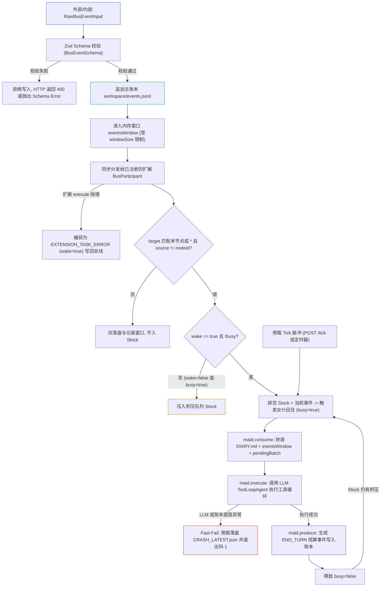

# World Bus Agent API 需求说明文档

> **文档状态**: 基于 `tests/` 全部 4 组测试（13 个用例）及核心运行时（`src/main.ts`, `src/types.ts`, `src/maid.ts`, `src/tools.ts`, `src/crash.ts`）反推并整理的接口与行为契约。
> **当前边界说明**: 仓库中存在部分未清理的旧版/AI 生成残留文件（`src/cli.ts`, `src/ControlServer.ts`, `src/loader.ts`, `src/validator.ts`, `src/WorldBusCore.ts`）, 导致 `tsc` 构建暂未通过；本文档以已通过 `vitest run` 验证的核心运行时接口为唯一基准。

---

## 1. 系统定位与核心架构意图

**World Bus Agent** 是一个基于**事件流控制反转（IoC）**的节点级智能体运行时。智能体（代号“女仆” / Maid）不主动轮询外部世界, 而是作为总线参与者被事件流被动驱动。

### 1.1 事件生命周期闭环（Pink Diagram）



---

## 2. 核心数据模型契约（Event Schema）

所有进入总线的事件必须符合 `BusEventSchema`（定义于 `src/types.ts`）：

| 字段 | 类型 | 必填 | 默认值 | 说明 |
| :--- | :--- | :--- | :--- | :--- |
| `id` | `string` | 系统生成 | `EVT-{timestamp}-{uuid5}` | 事件全局唯一标识（`RawBusEventInput` 无需传入） |
| `ts` | `string` | 系统生成 | ISO-8601 字符串 | 事件入账时间戳（`RawBusEventInput` 无需传入） |
| `source` | `string` | 是 | - | 事件来源节点或模块 ID（如 `"user"`, `"wet.sentinel"`, `"external.http"`） |
| `target` | `string` | 否 | `"*"` | 目标节点 ID, `"*"` 表示广播 |
| `type` | `string` | 是 | - | 事件类型（如 `"USER_AIM"`, `"END_TURN"`, `"EXTENSION_TASK_ERROR"`） |
| `prompt` | `string` | 是 | - | 事件的自然语言描述或指令正文（缺失时必须拦截报错） |
| `wake` | `boolean` | 否 | `false` | 是否立即唤醒女仆；`false` 仅进 `Stock` 积累 |
| `responseMode` | `"optional" \| "respond" \| "tool_required"` | 否 | `"optional"` | 约束 LLM 本轮的响应强度与工具调用策略 |
| `outbound` | `boolean` | 否 | `true` | 是否属于对外/跨节点事件标志 |
| `payload` | `Record<string, unknown>` | 否 | `{}` | 结构化业务载荷 |

### 2.1 内置保留事件类型

1. **`END_TURN`**: 女仆回合结算事件（`wake: false`, `outbound: false`）, 由 `maid.produce` 生成。
   - `payload.processedEventIds`: `string[]`, 本轮已签收消费的事件 ID 列表, 用于断电重启时去重恢复 `Stock`。
   - `payload.toolTrace`: `Array<{ toolName: string; args: unknown }>`, 本轮实际调用的工具轨迹。
   - `payload.tokenUsage` *(可选)*: `TokenUsageStats`, 记录估算输入 Token (`estimatedInputTokens`), 淘汰早期历史条数 (`droppedHistoryEvents`) 及真实 API 消耗 (`apiInputTokens`, `apiOutputTokens`, `apiTotalTokens`)。
2. **`EXTENSION_TASK_ERROR`**: 扩展执行期任务异常事件（`wake: true`, `responseMode: "respond"`, `outbound: true`）。
   - `payload.failedParticipant`: 报错扩展的 `id`。
   - `payload.triggerEventId`: 引发异常的原事件 `id`。
   - `payload.error`: 异常错误消息文本。

---

## 3. HTTP 控制面 API（Control Surface）

运行时通过 `Hono` 暴露本地 HTTP 控制服务（默认监听 `127.0.0.1`, 端口由 `RuntimeConfig.port` 或 `AGENT_PORT` 指定, 默认 `3100`）。

### 3.1 `POST /events` — 注入事件到总线

- **请求头**: `Content-Type: application/json`
- **请求体**: 符合 `RawBusEventInput` 的 JSON 对象。若省略 `source`, 运行时自动补全为 `"external.http"`。
  ```json
  {
    "type": "WATCHDOG_HIT",
    "prompt": "检测到新谱图落盘",
    "wake": false,
    "target": "leadership.center",
    "responseMode": "optional",
    "payload": {}
  }
  ```
- **成功响应 (`201 Created`)**:
  ```json
  {
    "ok": true,
    "event": {
      "id": "EVT-...",
      "ts": "2026-11-18T00:00:00.000Z",
      "source": "external.http",
      "target": "*",
      "type": "WATCHDOG_HIT",
      "prompt": "检测到新谱图落盘",
      "wake": false,
      "responseMode": "optional",
      "outbound": true,
      "payload": {}
    }
  }
  ```
- **失败响应 (`400 Bad Request`)**:
  - 触发条件: 缺少必填字段（如 `prompt` 或 `type`）, 或 JSON 结构不合法。
  - 行为约束: **严禁写入 `events.jsonl` 账本**, 返回错误原因：
    ```json
    {
      "ok": false,
      "error": "Invalid Event Schema from [external.http]: ..."
    }
    ```

### 3.2 `GET /status` — 查询节点运行状态快照

- **成功响应 (`200 OK`)**:
  ```json
  {
    "nodeId": "leadership.center",
    "crashed": false,
    "busy": false,
    "stockCount": 1,
    "stock": [ ... ],
    "windowCount": 1,
    "recentWindow": [ ... ],
    "tools": ["read_file", "write_file", "list_dir", "exec_cli", "emit_event"]
  }
  ```
  - `recentWindow`: 最近至多 10 条窗口事件。
  - `tools`: 当前已注册（原生 + 扩展）的全部工具名称列表。

### 3.3 `POST /tick` — 触发旁路脉冲排空 Stock

- **用途**: 由外部定时器, cron 或人工操作触发, 强制一次性排空积压在 `Stock` 中的静默事件（`wake: false`）并唤醒女仆处理。
- **成功响应 (`200 OK`)**:
  ```json
  {
    "ok": true,
    "stockRemaining": 0
  }
  ```

### 3.4 `GET /llm/providers` — 查询内置 LLM 提供商预设列表

- **用途**: 返回支持的模型提供商模板（含 `id`, `protocol`, `defaultBaseURL`, `defaultModel`, `description`, 不包含任何密钥）。
- **成功响应 (`200 OK`)**:
  ```json
  {
    "ok": true,
    "providers": [ ... ]
  }
  ```

### 3.5 `POST /llm/test` — 执行 LLM 连通性探针测试

- **用途**: 不传参时直接校验当前节点配置；也可传入临时 `{ provider?, baseURL?, apiKey?, model? }` 覆盖字段进行连通性探针测试。
- **成功响应 (`200 OK`)** / **失败响应 (`400 Bad Request`)**:
  ```json
  {
    "ok": true,
    "provider": "deepseek",
    "protocol": "openai-compatible",
    "model": "deepseek-chat",
    "baseURL": "https://api.deepseek.com/v1",
    "latencyMs": 947,
    "reply": "OK"
  }
  ```

---

## 4. 运行时与扩展编程接口（Runtime & Extension SDK）

### 4.1 `createAgentRuntime(config, overrides?)`

创建并启动一个节点运行时实例（`src/main.ts`）：

- **输入参数 `RuntimeConfig`**:
  - `nodeId`: 节点标识（如 `"leadership.center"`）
  - `workspaceDir`: 工作区目录路径（包含 `events.jsonl`, `DIARY.md`, `crashes/`, `CRASH_LATEST.json`）
  - `port`: HTTP 服务端口
  - `windowSize`: 内存事件窗口大小上限
  - `tickIntervalMs`: 自动脉冲周期（`0` 表示禁用自动定时 Tick）
  - `llm`: `{ enabled, provider?, baseURL?, apiKey, model?, systemPrompt, maxSteps }`（未填 `baseURL` / `model` 时根据 `provider` 或 `apiKey` 前缀自动填充预设）
  - `budget` *(可选)*: `{ maxContextTokens?, maxDiaryTokens?, maxFieldChars?, compactionWatermarkRatio? }`
  - `extensions`: `Array<{ module: string; enabled?: boolean; options?: Record<string, unknown> }>`（相对路径基于 `process.cwd()` 解析）
- **测试/注入钩子 `RuntimeOverrides`**:
  - `maidExecute`: 替换真实 LLM 网络请求, 便于离线单测或自定义执行器
  - `onExit`: 拦截 `process.exit(1)` 以供测试断言 Fast-Fail 退出码
- **返回值**:
  - `bus`: `WorldBusContext`
  - `app`: `Hono` 实例（可用于 `app.request(...)` 端到端测试）
  - `tools`: 已挂载的工具映射表
  - `getState()`: 返回 `{ busy, crashed, stock, eventsWindow }`

### 4.2 `WorldBusContext` 与扩展接口 (`AgentExtension`)

扩展模块需默认导出 `AgentExtension` 函数：`(bus: WorldBusContext, options?) => Promise<void> | void`。

`WorldBusContext` 提供以下能力：
- `nodeId`: 只读当前节点 ID
- `workspaceDir`: 只读工作区绝对路径
- `ingest(raw)`: 校验并落盘事件, 依次触发已注册参与者, 并按 `wake` / `target` 路由至女仆或 `Stock`
- `tick(reason?)`: 触发一次积压排空回合
- `registerParticipant(participant)`: 注册事件总线参与者
- `registerTool(name, toolDef)`: 向女仆 LLM 注册新工具（Vercel AI SDK `Tool`）
- `onCrash(handler)`: 注册底层崩溃旁路回调

### 4.3 纯总线收发契约 (`BusParticipant`)

所有接入总线的参与者（包括女仆本体 `src/maid.ts` 与外部扩展）必须遵守纯函数转换与异步执行分离的设计：

- **`consume(eventsWindow, pendingBatch, extraContext?)`**（纯函数, 无外部 I/O）:
  - 当待消费集合为空时返回 `null`。
  - 女仆实现需求：若存在 `extraContext.diary`（即 `workspace/DIARY.md`）, 需拼入提示词第 0 节（受 `maxDiaryTokens` 限制）；随后对 `pendingBatch` 与 `eventsWindow` 执行单字段掐头留尾截断, 并从最新到最旧对历史窗口按剩余 Token 预算倒序装箱；超水位线（默认 `75%`）或淘汰早期历史时注入 `【上下文水位告警】`；若 `pendingBatch` 中任一事件 `responseMode === "tool_required"`, 必须设置 `requiresTool = true` 并在提示词中注入 `【强制调用工具】` 约束。
- **`execute(input, bus)`**（异步算子）: 执行实际外部交互（LLM 请求, 数据库检查, 硬件调用等）。
- **`produce(output)`**（纯函数, 无外部 I/O）: 将执行结果打包为待入账的 `RawBusEventInput[]`（女仆实现为生成单条 `END_TURN` 事件）。

---

## 5. 原生工作区工具契约（Native Workspace Tools）

由 `createNativeWorkspaceTools(bus)`（`src/tools.ts`）提供给 LLM 调用, 所有路径均受 `workspaceDir` 沙箱限制：

| 工具名 | 参数 | 行为与安全约束 |
| :--- | :--- | :--- |
| `read_file` | `{ path: string }` | 读取工作区内文件；**路径越界（如 `../../etc/passwd`）必须拦截**, 返回 `{ ok: false, path, error: "路径越界拒绝访问: ..." }` |
| `write_file` | `{ path: string, content: string }` | 写入/覆盖工作区内文件（自动创建父目录）, 返回 `{ ok: true, path, bytes }` |
| `list_dir` | `{ path?: string }`（默认 `"."`） | 列出目录条目 `entries: Array<{ name, type: "file" \| "dir" }>` |
| `exec_cli` | `{ command: string, timeoutMs?: number }`（默认 `30000`） | 在 `workspaceDir` 下执行本地命令行/脚本；**非 0 退出码时零静默**, 完整返回 `{ ok: false, exitCode, command, stdout, stderr }`, **严禁杀死主进程** |
| `emit_event` | `{ type, target?, prompt, wake?, responseMode?, payload? }` | 向总线注入新事件, 自动填充 `source = bus.nodeId`。<br>**防自激铁律**: 若 `target === bus.nodeId` 或 `target === "*"`, **必须强制覆盖 `wake = false`**；仅当 `target` 为其他远端节点时才保留调用方传入的 `wake` 值 |

---

## 6. 引擎关键不变量与双层错误隔离规范

### 6.1 生命周期与断电恢复不变量

1. **Busy 互斥锁与自动续接**:
   - 女仆执行回合期间（`busy === true`）, 无论新到事件的 `wake` 为 `true` 还是 `false`, 均强制压入 `Stock` 排队。
   - 本轮 `END_TURN` 落盘且 `busy` 释放后, 若 `Stock` 非空且节点未崩溃, 必须立即自动发起下一轮排空（`triggerReason: "DRAIN_STOCK_AFTER_END_TURN"`）。
2. **断电无损恢复**:
   - 启动时读取 `workspace/events.jsonl` 恢复最近 `windowSize` 条记录至 `eventsWindow`。
   - 扫描所有历史 `END_TURN.payload.processedEventIds` 建立已签收集合 `settledIds`。
   - 仅将 `source !== nodeId` 且 `target` 为本节点或 `"*"` 且 **不在 `settledIds` 中** 的历史事件重新装回 `Stock`。

### 6.2 双层错误隔离模型

| 层级 | 触发场景 | 处理策略 | 对主账本与进程的影响 |
| :--- | :--- | :--- | :--- |
| **Layer 1: 事件报错 (Task Error)** | 扩展 `BusParticipant.execute` 抛出业务异常；`exec_cli` 退出码非 0；文件工具路径越界 | 异常捕获并降级为工具返回值或生成 `EXTENSION_TASK_ERROR` 事件（`wake: true`）唤醒女仆处理 | **不杀进程**, 不生成 `CRASH_LATEST.json`, 由 LLM 自主决策重试或告警 |
| **Layer 2: 底层报错 (Underlying Crash / Fast-Fail)** | `BOOT`（启动账本行 JSON 损坏或扩展加载失败）, `LEDGER_IO`（账本写入失败）, `MAID_TURN`（LLM 底层算子/网络崩溃）, `UNCAUGHT`（未捕获进程异常） | 调用 `dumpCrashReportSync` 同步写入 `workspace/crashes/CRASH-{ts}.json` 与 `workspace/CRASH_LATEST.json`, 触发 `onCrash` 钩子（1.5s 超时保护）, 调用 `exitFn(1)` | **严禁向 `events.jsonl` 写入伪造事件或 `END_TURN`**, 确保账本干净以便修复后重启无损恢复 `Stock` |
