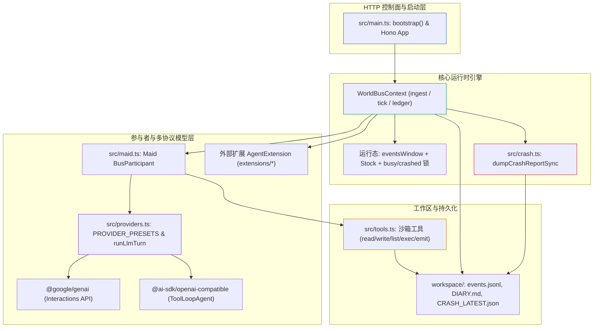
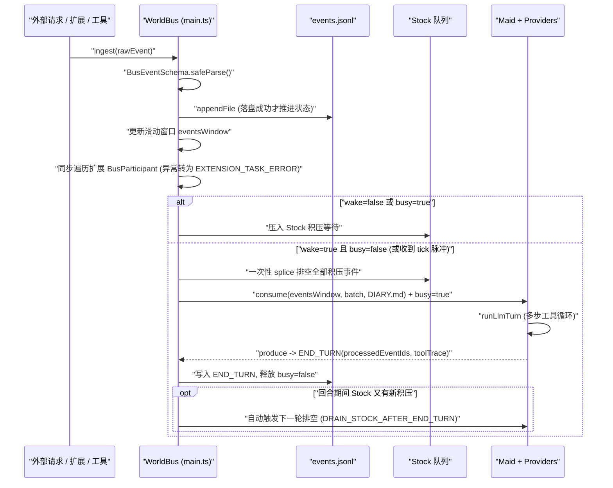

# World Bus Agent 架构设计文档

> **文档说明**: 本文档描述 `world-bus-agent` 当前已跑通的最小核心架构, 模块职责边界与关键运行机制。接口字段与请求体契约详见 [API_REQUIREMENTS.md](./API_REQUIREMENTS.md)。

---

## 1. 核心设计哲学

1. **事件流控制反转（IoC）**: 智能体（代号“女仆” / Maid）不作为主控轮询循环运行, 而是作为事件总线上的一个普通参与者（`BusParticipant`）。所有外部指令, 定时脉冲, 传感器告警与工具结果均统一抽象为事件, 被动触发女仆回合。
2. **账本先于状态（Ledger-First）**: 所有合法事件在进入内存逻辑前, 必须先通过 `BusEventSchema` 校验并持久化追加至 `workspace/events.jsonl`。内存中的 `eventsWindow` 与待处理积压区 `Stock` 均由账本派生, 保证断电重启可无损恢复。
3. **纯收发契约分离**: 任意总线参与者必须将无外部 I/O 副作用的 `consume`（组装上下文）与 `produce`（打包新事件）同有副作用的 `execute`（网络, 磁盘, LLM 推理）解耦, 确保核心流转逻辑可离线确定性测试。
4. **双层错误隔离**: 业务层/工具/扩展报错转为总线事件交由智能体自愈；底层基础设施（账本损坏, 启动失败, LLM 算子崩溃）严格执行 Fast-Fail 旁路落盘而不污染主账本。

---

## 2. 系统总体拓扑与模块依赖

### 2.1 核心文件职责清单

| 文件 | 核心职责 | 对外暴露/关键符号 |
| :--- | :--- | :--- |
| `src/types.ts` | 核心领域模型与总线契约定义 | `BusEventSchema`, `BusEvent`, `RawBusEventInput`, `BusParticipant`, `WorldBusContext`, `AgentExtension` |
| `src/main.ts` | 生命周期引擎, 账本恢复, HTTP 控制面与启动入口 | `createAgentRuntime`, `bootstrap`, `RuntimeConfig`, `RuntimeOverrides` |
| `src/maid.ts` | 女仆总线参与者（上下文拼装与 `END_TURN` 结算） | `createMaidParticipant`, `MaidConsumedPrompt`, `MaidTurnResult` |
| `src/providers.ts` | 泛用提供商预设解析, 多协议推理调度与连通性探针 | `PROVIDER_PRESETS`, `resolveLlmConfig`, `createLanguageModel`, `runLlmTurn`, `testLlmConnection` |
| `src/tools.ts` | 受限工作区沙箱工具集与防自激事件发射器 | `createNativeWorkspaceTools` (`read_file`, `write_file`, `list_dir`, `exec_cli`, `emit_event`) |
| `src/crash.ts` | 旁路同步崩溃落盘器 | `dumpCrashReportSync`, `CrashReport` |
| `src/index.ts` | 包入口重导出 | `types`, `crash`, `ai.tool`, `zod.z` |

---

## 3. 核心机制设计详解

### 3.1 事件生命周期与调度不变量

### 3.2 断电无损恢复机制

节点重启调用 `createAgentRuntime` 时, 按以下规则重建内存态：
1. 若 `workspace/events.jsonl` 存在, 逐行解析并经 `BusEventSchema` 校验；**任何一行损坏立即判定为 `BOOT` 级底层崩溃并 Fast-Fail**, 防止带病运行。
2. 截取最后 `windowSize` 条事件填入 `eventsWindow`。
3. 收集所有历史 `END_TURN` 事件的 `payload.processedEventIds` 形成已签收集合 `settledIds`。
4. 过滤出满足 `source !== nodeId && (target === nodeId || target === "*") && !settledIds.has(id)` 的历史事件重新装入 `Stock`, 确保断电前未处理完的任务不丢失且已处理任务不重复消费。

### 3.3 多协议泛用模型层 (`src/providers.ts`)

为兼顾最新 Gemini 官方接口与广大 OpenAI 兼容生态, 运行时采用双协议统一调度：

- **自动模板补全**: 通过 `resolveLlmConfig` 读取 `provider` 与 `apiKey` 前缀（`AQ.` / `AIza` 自动识别为 `gemini`, 其他默认 `openai-compatible`）, 自动填充默认 `baseURL` 与 `model`, 用户仅填密钥即可完成配置并支持 `POST /llm/test` 测通。
- **协议分发 (`runLlmTurn`)**:
  - **`google-genai` 协议**: 使用 `@google/genai` SDK 的 `ai.interactions.create`。通过 `ai.asSchema` 将注册的 `Tool` 动态转为 JSON Schema 函数声明, 并在本地驱动 `FunctionCallStep` -> 本地工具执行 -> `FunctionResultStep`（通过 `previous_interaction_id` 续接会话）的多步工具循环。首次调用若 `requiresTool=true` 设 `tool_choice: "any"`, 后续工具结果回传阶段切换为默认自动模式以避免死循环。
  - **`openai-compatible` 协议**: 使用 `@ai-sdk/openai-compatible` 配合 Vercel AI SDK 的 `ToolLoopAgent` 与 `stepCountIs(maxSteps)` 驱动统一工具循环, 覆盖 OpenAI, DeepSeek, OpenRouter, Ollama, vLLM 等端点。

### 3.4 安全边界与双层错误隔离

1. **沙箱与防自激 (`src/tools.ts`)**:
   - `read_file` / `write_file` / `list_dir` 通过 `resolveSafePath` 强制限制在 `workspaceDir` 内, 路径越界直接返回 `{ ok: false, error }` 交由 LLM 感知。
   - `exec_cli` 捕获非 0 退出码并完整返回 `exitCode`, `stdout`, `stderr`, 不杀主进程。
   - `emit_event` 对 `target === bus.nodeId` 或 `target === "*"` 的事件强制覆盖 `wake = false`, 防止女仆向自身发射唤醒事件引发无限自激循环。
2. **双层错误隔离**:
   - **Layer 1 (Task Error)**: 扩展 `execute` 异常捕获为 `EXTENSION_TASK_ERROR`（`wake: true`）回注总线, 由女仆决策处理；不触发崩溃退出。
   - **Layer 2 (Underlying Crash)**: `BOOT`, `LEDGER_IO`, `MAID_TURN`, `UNCAUGHT` 阶段异常通过 `dumpCrashReportSync` 同步写入 `workspace/crashes/CRASH-{ts}.json` 与 `workspace/CRASH_LATEST.json`, 触发 `onCrash` 回调（1.5s 超时保护）并以退出码 `1` 终止, **严禁向 `events.jsonl` 写入任何伪造事件**。

---

## 4. 上下文窗口治理与后续演进

### 4.1 女仆内置上下文窗口治理 (`src/maid.ts`)

上下文裁剪与 Token 管理完全内聚于 `Maid` 自身（`consume` 保持 100% 纯函数, 不侵入 `main.ts` 总线调度）：
1. **单条掐头留尾截断 (`truncateMiddle`)**: 超出 `maxFieldChars`（默认 `1600`）的长文本保留前 `45%` + 后 `45%`, 已结算历史字段限额进一步收紧为 `50%`。
2. **刚性保底与弹性倒序装箱**: `pendingBatch` 与 `DIARY.md`（上限 `maxDiaryTokens`, 默认 `2000`）优先扣除预算；`eventsWindow` 使用剩余预算从最新向最旧倒序装填, 超出 `maxContextTokens`（默认 `12000`）即淘汰早期记录。
3. **高水位自动归档提示**: 当历史条目被淘汰或占用率达到 `compactionWatermarkRatio`（默认 `75%`）时, 自动追加 `【上下文水位告警】`, 引导女仆调用 `write_file` 压缩沉淀长期状态至 `DIARY.md`。
4. **Token 账单回写**: `execute` 汇总估算及真实 API `usage` 后, 由 `produce` 写入 `END_TURN.payload.tokenUsage`。

### 4.2 已知演进方向

1. **跨节点总线桥接**: 当前 `outbound` 字段已预留但尚无实际网络/消息队列桥接扩展（如 Redis Stream / HTTP Peer Relay）, 节点间通信目前仅在契约层就位。
2. **优雅停机与热更新**: 当前尚缺少 `runtime.shutdown()` 清理端口与定时脉冲句柄, 以及运行时配置热更新（`POST /config/llm`）接口。
